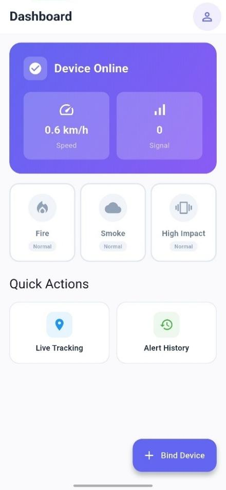
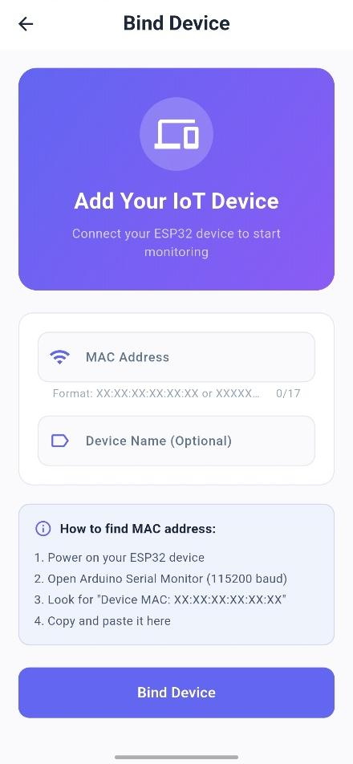
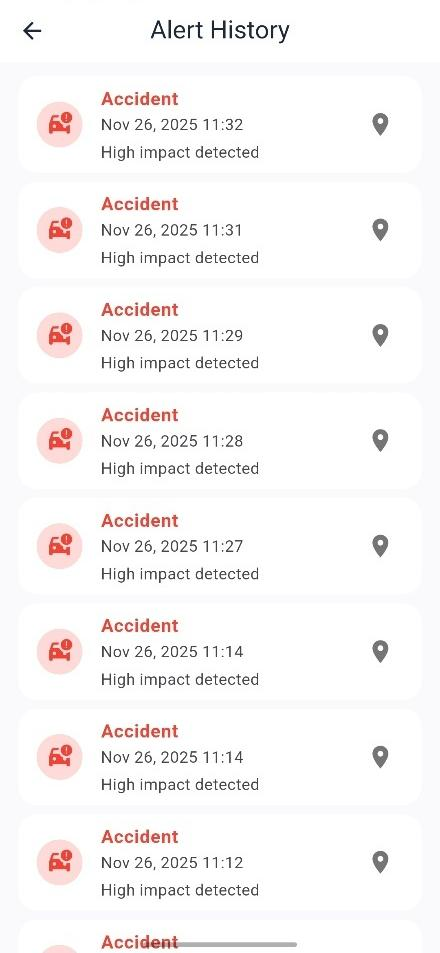

<div align="center">

# 🚨 IoT Automatic Accident Alert System


**An IoT-based system for automatic accident detection and alerting**

[Overview](#overview) • [Features](#features) • [System Architecture](#system-architecture) • [Hardware Components](#hardware-components) • [Technology Stack](#technology-stack) • [Project Structure](#project-structure) • [Getting Started](#getting-started) • [Configuration](#configuration) • [Usage](#usage) • [API Documentation](#api-documentation) • [Screenshots](#screenshots) • [License](#license)

</div>

---

## 📖 Overview

The IoT Automatic Accident Alert System is a real-time safety monitoring solution designed to detect vehicular accidents and environmental hazards. When an accident or hazard is detected, the system automatically sends emergency alerts via SMS and updates a mobile application with live telemetry data.

### Key Capabilities:
- **Accident Detection**: Uses MPU6050 accelerometer/gyroscope to detect impacts and tilts
- **Environmental Monitoring**: Detects fire, smoke, and extreme temperatures
- **Real-time GPS Tracking**: Provides accurate location data with Google Maps integration
- **Dual Connectivity**: GPRS primary with WiFi fallback (for testing/demo purposes)
- **SMS Alerts**: Sends emergency notifications via GSM module or WiFi SMS gateway
- **Mobile App**: Flutter-based cross-platform app for real-time monitoring
- **Cloud Storage**: Firebase backend for data persistence and synchronization

---

## ✨ Features

### 🔧 Hardware Features
- Multi-sensor accident detection (impact + tilt detection)
- GPS location tracking with NEO-6M module
- Environmental hazard detection:
  - Fire detection (flame sensor)
  - Smoke/CO detection (MQ-7 sensor)
  - Temperature monitoring (DHT11 sensor)
- Dual connectivity modes (GPRS primary, WiFi backup for indoor testing)
- Emergency SMS alerts via GSM module or WiFi SMS gateway (demo fallback)
- Real-time telemetry data upload

### 💻 Backend Features
- RESTful API for device and mobile app communication
- HTTP-to-HTTPS bridge for SIM800L compatibility
- Firebase Realtime Database integration
- User authentication and device binding
- Data validation and sanitization
- Automatic data retention management
- Alert history and trip tracking

### 📱 Mobile App Features
- User authentication (Firebase Auth)
- Real-time GPS tracking visualization
- Live telemetry data display
- Sensor status monitoring
- Trip history with detailed logs
- Alert management system
- Emergency contact configuration
- Device settings control

---

## 🏗️ System Architecture

```
┌──────────────────────────────────────────────────────────┐
│                         ESP32 Device                     │
│  ┌──────────┐  ┌──────────┐  ┌──────────┐  ┌──────────┐  │
│  │ MPU6050  │  │ GPS NEO  │  │  DHT11   │  │   MQ-7   │  │
│  │(Accel/   │  │  (GPS)   │  │  (Temp)  │  │ (Smoke)  │  │
│  │  Gyro)   │  │          │  │          │  │          │  │
│  └─────┬────┘  └────┬─────┘  └────┬─────┘  └────┬─────┘  │
│        └────────────┴─────────────┴─────────────┘        │
│                           │                              │
│                    ┌──────▼──────┐                       │
│                    │   ESP32     │                       │
│                    │   Main      │                       │
│                    │  Controller │                       │
│                    └──────┬──────┘                       │
│                           │                              │
│              ┌────────────┴───────────┐                  │
│              │                        │                  │
│         ┌────▼─────┐            ┌─────▼────┐             │
│         │  WiFi    │            │ SIM800L  │             │
│         │ (Backup) │            │  (GPRS)  │             │
│         └────┬─────┘            └─────┬────┘             │
└──────────────┼────────────────────────┼──────────────────┘
               │                        │
               │ HTTPS                  │ HTTP
               │                        │
         ┌─────▼────────────────────────▼────┐
         │      Flask Backend Server         │
         │   (HTTP to HTTPS Bridge)          │
         │                                   │
         │  - Device API Routes              │
         │  - Mobile App API Routes          │
         │  - Data Validation                │
         │  - Authentication                 │
         └──────────────┬────────────────────┘
                        │ HTTPS
                        │
                 ┌──────▼────────┐
                 │   Firebase    │
                 │               │
                 │ - Realtime DB │
                 │ - Firestore   │
                 │ - Auth        │
                 └───────┬───────┘
                         │
                         │ Real-time Sync
                         │
                 ┌───────▼─────────┐
                 │  Flutter App    │
                 │  (Android/iOS)  │
                 │                 │
                 │ - Live Tracking │
                 │ - Alerts        │
                 │ - History       │
                 └─────────────────┘
```

---

## 🔩 Hardware Components

| Component | Model | Purpose |
|-----------|-------|---------|
| Microcontroller | ESP32 DevKit | Main processing unit with WiFi |
| Accelerometer/Gyroscope | MPU6050 | Impact and tilt detection |
| GPS Module | NEO-6M | Location tracking |
| GSM Module | SIM800L | GPRS data + SMS alerts |
| Temperature/Humidity | DHT11 | Environmental monitoring |
| Gas Sensor | MQ-7 | Carbon monoxide/smoke detection |
| Flame Sensor | IR Flame Sensor | Fire detection |

### Pin Configuration:
- **MPU6050**: I2C (SDA: GPIO21, SCL: GPIO22)
- **GPS NEO-6M**: Serial (RX: GPIO16, TX: GPIO17)
- **SIM800L**: Serial (RX: GPIO26, TX: GPIO27)
- **DHT11**: GPIO4
- **MQ-7**: GPIO34 (Analog)
- **Flame Sensor**: GPIO35 (Analog)

---

## 💾 Technology Stack

### 🔧 Firmware

<table>
<tr height="120">
<td align="center" width="150">

<br><strong>C++</strong>
<br><sub>Arduino Framework</sub>
</td>
<td align="center" width="150">

<br><strong>ESP32</strong>
<br><sub>Microcontroller</sub>
</td>
<td align="center" width="160">

<br><strong>IoT Sensors</strong>
<br><sub>MPU6050, NEO-6M, SIM800L</sub>
</td>
</tr>
</table>

**Key Libraries**: Wire (I2C), TinyGPS++, MPU6050, DHT, HTTPClient

---

### 🐍 Backend

<table>
<tr height="120">
<td align="center" width="150">

<br><strong>Python 3.11+</strong>
<br><sub>Core Language</sub>
</td>
<td align="center" width="150">

<br><strong>Flask</strong>
<br><sub>REST API Framework</sub>
</td>
<td align="center" width="150">

<br><strong>Firebase</strong>
<br><sub>Realtime DB + Firestore</sub>
</td>
<td align="center" width="150">

<br><strong>Render.com</strong>
<br><sub>Cloud Deployment</sub>
</td>
</tr>
</table>

**Key Libraries**: flask-cors, firebase-admin, python-dotenv, gunicorn

---

### 📱 Mobile App

<table>
<tr height="120">
<td align="center" width="150">

<br><strong>Flutter 3.x</strong>
<br><sub>Cross-platform</sub>
</td>
<td align="center" width="150">

<br><strong>Dart</strong>
<br><sub>Programming Language</sub>
</td>
<td align="center" width="150">

<br><strong>Firebase</strong>
<br><sub>Auth + Realtime Sync</sub>
</td>
<td align="center" width="150">


<br><strong>Android & iOS</strong>
<br><sub>Native Platforms</sub>
</td>
</tr>
</table>

**State Management**: Provider Pattern

---

## 📁 Project Structure

```
IoT-Automatic-Accident-Alert-System/
├── firmware/                    # ESP32 firmware
│   ├── main/                   # Main application
│   │   ├── main.ino           # Entry point
│   │   └── src/               # Modular components
│   │       ├── config.h       # Configuration (not in repo)
│   │       ├── config.h.example
│   │       ├── MPU.h/cpp      # Accelerometer module
│   │       ├── GPS.h/cpp      # GPS module
│   │       ├── SIM.h/cpp      # GSM/GPRS module
│   │       ├── SMS.h/cpp      # SMS gateway
│   │       ├── API.h/cpp      # Backend API client
│   │       └── Sensors.h/cpp  # Environmental sensors
│   └── tests/                 # Individual sensor tests
│
├── backend/                    # Flask REST API
│   ├── app.py                 # Main application
│   ├── config.py              # Configuration
│   ├── firebase_service.py    # Firebase operations
│   ├── middleware.py          # Auth & validation
│   ├── routes/                # API endpoints
│   │   ├── device_routes.py  # Device API
│   │   └── app_routes.py     # Mobile app API
│   ├── requirements.txt       # Python dependencies
│   ├── .env.example          # Environment variables template
│   └── firebase-service-account.json.example
│
├── mobile-app/                # Flutter application
│   ├── lib/
│   │   ├── main.dart         # App entry point
│   │   ├── models/           # Data models
│   │   ├── providers/        # State management
│   │   ├── services/         # API & business logic
│   │   ├── screens/          # UI screens
│   │   └── widgets/          # Reusable components
│   ├── android/              # Android config
│   ├── ios/                  # iOS config
│   └── pubspec.yaml          # Flutter dependencies
│
├── SECURITY.md               # Security configuration guide
├── .gitignore               # Git ignore rules
└── README.md                # This file
```

---

## 🚀 Getting Started

### Prerequisites
- **Hardware**: ESP32, sensors (see [Hardware Components](#hardware-components))
- **Software**:
  - Arduino IDE or PlatformIO
  - Python 3.11+
  - Flutter SDK 3.x
  - Firebase account
  - Mobile carrier SIM card (for GPRS)

### Quick Start Guide

#### 1️⃣ Clone the Repository
```bash
git clone https://github.com/sujayamindev/IoT-Automatic-Accident-Alert-System.git
cd IoT-Automatic-Accident-Alert-System
```

#### 2️⃣ Configure Credentials

```bash
# Firmware
cp firmware/main/src/config.h.example firmware/main/src/config.h
# Edit config.h with your WiFi, phone numbers, etc.

# Backend
cp backend/.env.example backend/.env
# Edit .env with your Firebase credentials
# Download firebase-service-account.json from Firebase Console

# Mobile App
cd mobile-app
flutterfire configure
```

#### 3️⃣ Hardware Setup
1. Connect all sensors to ESP32 according to pin configuration
2. Power the ESP32 via USB or external power supply
3. Ensure SIM800L has adequate power (requires 2A peak current)

#### 4️⃣ Upload Firmware
```bash
# Open firmware/main/main.ino in Arduino IDE
# Select ESP32 board and port
# Click Upload
```

#### 5️⃣ Start Backend Server
```bash
cd backend
pip install -r requirements.txt
python app.py
# Server runs on http://localhost:5000
```

#### 6️⃣ Run Mobile App
```bash
cd mobile-app
flutter pub get
flutter run
```

---

## ⚙️ Configuration

### Firmware Configuration (`firmware/main/src/config.h`)

```cpp
// WiFi Settings
constexpr const char* WIFI_SSID = "YourWiFiName";
constexpr const char* WIFI_PASSWORD = "YourWiFiPassword";

// Backend API
constexpr const char* BACKEND_API_URL = "https://your-backend.onrender.com";

// Emergency Contacts
inline const char* const PHONE_NUMBERS[] = {
    "+94771234567",
    "+94779876543"
};

// Sensor Thresholds
constexpr const int IMPACT_THRESHOLD = 30000;  // Accelerometer threshold
constexpr const int TILT_ANGLE_THRESHOLD = 45;  // Tilt angle in degrees
constexpr const float EXTREME_TEMP_THRESHOLD = 50.0;  // °C
```

### Backend Configuration (`backend/.env`)

```env
SECRET_KEY=your-secret-key
FIREBASE_PROJECT_ID=your-project-id
FIREBASE_DATABASE_URL=https://your-project.firebasedatabase.app
FIREBASE_CREDENTIALS_PATH=./firebase-service-account.json
```

### Mobile App Configuration
- Uses Firebase auto-configuration via FlutterFire CLI
- Update `lib/services/api_service.dart` with backend URL

---

## 📖 Usage

### Device Operation

1. **Power On**: ESP32 initializes all sensors
2. **Connectivity**: 
   - **Production Mode**: Attempts GPRS first, falls back to WiFi if unavailable
   - **Demo Mode**: WiFi + SMS gateway for reliable indoor demonstrations
3. **Normal Operation**: Uploads telemetry every 1 second
4. **Accident Detection**: 
   - Detects impact or tilt
   - Sends SMS via GSM module (or WiFi SMS gateway in demo mode)
   - Uploads alert to backend
   - Mobile app receives real-time notification

> **Note**: WiFi connectivity and SMS gateway are implemented as backup options for testing and demonstration purposes, particularly useful for indoor environments where GPRS signal may be weak or unavailable.

### Mobile App Usage

1. **Login/Register**: Create account with Firebase Auth
2. **Bind Device**: Enter device MAC address to link
3. **Live Tracking**: View real-time GPS location and sensor data
4. **History**: Browse trip history and past alerts
5. **Settings**: Configure device settings and emergency contacts

---

## 📡 API Documentation

### Device Endpoints

#### Upload Telemetry
```http
POST /api/device/uploadTelemetry
Content-Type: application/x-www-form-urlencoded

deviceId=AA:BB:CC:DD:EE:FF
lat=6.9271
lng=79.8612
spd=45.5
fire=0
smoke=0
temp=28.5
```

#### Fetch Config
```http
GET /api/device/fetchConfig?deviceId=AA:BB:CC:DD:EE:FF
```

### Mobile App Endpoints

#### Bind Device
```http
POST /api/app/bindDevice
Authorization: Bearer <firebase-token>

{
  "macAddress": "AA:BB:CC:DD:EE:FF",
  "deviceName": "My Car Device"
}
```

#### Get Live Data
```http
GET /api/app/getLiveData
Authorization: Bearer <firebase-token>
```

For full API documentation, see [`backend/README.md`](backend/README.md).

---

## 📸 Screenshots

<div align="center">

### Mobile Application

  

</div>

---

## 📄 License

This project was developed for **educational purposes** as part of academic coursework

---

## 🔮 Future Enhancements

- [ ] Machine learning for accident severity prediction
- [ ] Integration with emergency services APIs
- [ ] Web dashboard for fleet management
- [ ] OBD-II integration for vehicle diagnostics
- [ ] Voice alerts in mobile app
- [ ] Multi-language support
- [ ] Offline mode with local storage

---

<div align="center">
  <sub>🎓 Developed as part of HNDSE 2nd Year IoT Module Coursework</sub>
</div>